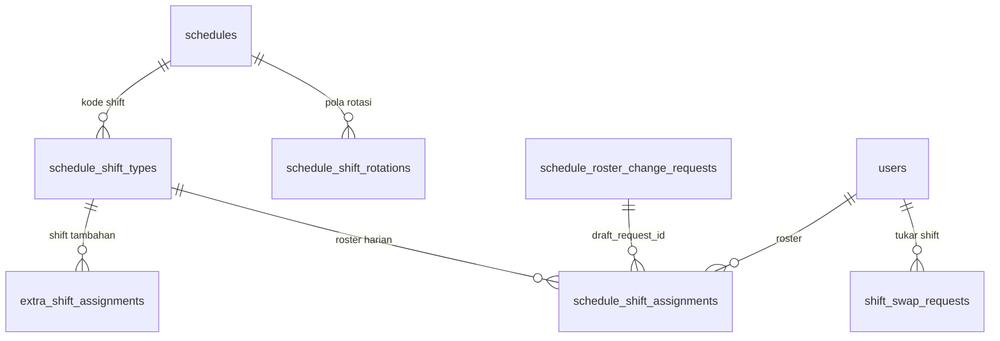

# Struktur Tabel Jadwal Shift & Cara Kerjanya

Ringkasan tabel jadwal tipe **Shift** dan alur kerjanya, dari membuat jadwal sampai dibaca presensi.

Sumber: `app/Models/Shift/`, `app/Services/Shift/`, `app/Services/Attendance/`, dan migration.

---

## 1. Gambaran besar

Jadwal punya tiga tipe (`ScheduleType`): Fixed, Flexible, dan Shift. Untuk **Shift**, jadwal itu sendiri hanya kamus kode shift (Pagi, Siang, Malam, dst). Siapa kerja shift apa pada tanggal berapa disimpan di **roster harian**.



`schedule_shift_assignments` tidak punya `schedule_id`. Jadwal induknya dicari lewat `shift_type_id → schedule_shift_types.schedule_id`.

---

## 2. Tabel

### `schedules` — header jadwal

| Kolom | Keterangan |
|---|---|
| `company_id`, `name` | Perusahaan dan nama jadwal. |
| `schedule_type` | `fixed` / `flexible` / `shift`. |
| `use_template` | Jika true, roster bisa digenerate dari pola rotasi. |
| `head_user_id` | Kepala Ruangan jadwal ini (nullable). |
| `allow_oncall_extra_shift` | Jika true, Oncall boleh dipilih sebagai Extra Shift. |
| `color`, `off_bg_color`, `off_font_color` | Warna tampilan. |

### `schedule_shift_types` — kode shift

Satu baris = satu kode shift di bawah satu jadwal. Unik `(schedule_id, code)`.

| Kolom | Keterangan |
|---|---|
| `schedule_id`, `code`, `name` | Jadwal induk, kode singkat, nama. |
| `shift_type` | `pagi` / `siang` / `malam` / `oncall`. |
| `start_time`, `end_time`, `break_minutes` | Jam kerja dan istirahat. |
| `is_overnight` | Shift lewat tengah malam. |
| `late_tolerance_minutes`, `early_leave_tolerance_minutes` | Toleransi telat / pulang cepat. |
| `checkin_buffer_minutes`, `checkout_buffer_minutes` | Jendela absen di luar jam shift. |
| `overtime_before_*`, `overtime_after_*` | Konfigurasi lembur sebelum/sesudah shift. |
| `counted_work_days`, `max_work_minutes`, `half_day_threshold_minutes`, `absent_threshold_minutes` | Bobot hari kerja dan ambang setengah hari / absen. |
| `color`, `font_color` | Warna sel di grid roster. |

Oncall diperlakukan khusus: tidak ada konsep telat atau pulang cepat, jam masuk bebas, target durasi dari `max_work_minutes`.

### `schedule_shift_assignments` — roster harian (tabel inti)

**Satu baris = satu karyawan pada satu tanggal.** Unik `(user_id, date)`.

| Kolom | Keterangan |
|---|---|
| `company_id`, `user_id`, `date` | Siapa dan kapan. |
| `shift_type_id` | Shift yang berlaku. Null jika Libur. |
| `off_day` | `true` = Libur eksplisit. |
| `schedule_status` | `cuti` / `izin` jika Libur otomatis karena Cuti/Izin disetujui (sel dikunci dari edit biasa). |
| `source_request_id` | Pengajuan presensi yang membuat sel ini Libur otomatis. |
| `draft_request_id`, `draft_shift_type_id`, `draft_off_day` | Usulan perubahan yang menunggu approval (lihat §3.3). |
| `notes`, `created_by` | Catatan dan pembuat. |

Tiga keadaan sel:
- baris ada dan `shift_type_id` terisi: kerja;
- baris ada dan `off_day = true`: Libur;
- baris tidak ada: belum diisi.

### `schedule_shift_rotations` — pola rotasi (opsional)

Dipakai jika `use_template = true`. Satu baris = satu posisi hari dalam siklus rotasi satu karyawan. Unik `(schedule_id, user_id, day)`.

| Kolom | Keterangan |
|---|---|
| `schedule_id`, `user_id` | Jadwal dan karyawan. |
| `day` | Posisi hari ke-N dalam siklus (mulai 1). |
| `shift_type_id` / `off_day` | Shift hari itu, atau Libur. |

Panjang siklus = jumlah baris rotasi karyawan itu. Tanggal mulai tidak disimpan, dipilih saat generate.

### Tabel pendukung roster

- `schedule_shift_roster_logs`: riwayat perubahan, satu baris per sel yang berubah (`old_value`, `new_value` berisi `shift_type_id` atau `'off'`, `source` = `manual` / `generate` / `reset` / `swap_conflict`, `changed_by`).
- `schedule_roster_change_requests`: pembungkus pengajuan perubahan roster (`schedule_id`, `period`, `requested_by`, `status` = `in_review` / `approved` / `rejected` / `cancelled`). Isi usulan ada di kolom `draft_*` baris roster, bukan di sini.

### `shift_swap_requests` — tukar shift

| Kolom | Keterangan |
|---|---|
| `requester_id`, `target_id` | Pemohon dan rekan. |
| `req_schedule_id`, `target_schedule_id` | Baris roster masing-masing pihak. |
| `req_date`, `target_date` | Tanggal masing-masing shift. |
| `swap_kind` | `schedule` (tukar shift) atau `reciprocal_off` (tukar libur berpasangan). |
| `status` | `pending` / `in_review` / `approved` / `rejected`. |
| `target_response` | Tanggapan rekan: `accepted` / `declined`. |
| `execution_log` | JSON log perubahan saat dieksekusi, dipakai untuk membatalkan. |

### Extra shift

Shift tambahan penuh di tanggal yang karyawan sudah punya shift normal. Dipisah dari roster karena roster unik per `(user_id, date)`.

- `extra_shift_assignments`: `user_id`, `covering_user_id`, `shift_type_id`, `date`, `status`, `source`, `category` (`extra_shift` = dapat jasa, `double_shift` = akibat tukar shift bentrok, tanpa jasa), `origin_shift_swap_request_id`.
- `extra_shift_rules`: pasangan shift asal → tujuan yang diizinkan per perusahaan, plus nominal jasa.
- `extra_shift_attendance_records`: jam kerja aktual extra shift (terpisah dari `attendance_records`).

### Tabel lama (jangan dipakai untuk fitur baru)

`m_shifts`, `shift_schedule_assignments`, `shift_templates`, `shift_template_days`. `attendance_records.schedule_id` masih menunjuk ke tabel lama, bukan roster baru.

---

## 3. Cara kerja

### 3.1 Menyiapkan jadwal

1. Buat `schedules` bertipe `shift`.
2. Tambahkan kode shift di `schedule_shift_types`.
3. Opsional: isi `schedule_shift_rotations` per karyawan jika memakai rotasi.

### 3.2 Mengisi roster

Roster diisi di grid karyawan × tanggal per bulan:

- **Manual:** pilih shift atau Libur per sel. Perubahan ditulis massal (`RosterBatchWriter`) dan dicatat ke `schedule_shift_roster_logs`.
- **Generate dari rotasi:** pilih tanggal mulai dan hari ke-berapa di siklus. Posisi siklus untuk tanggal D:

  ```
  diff   = selisihHari(tanggalMulai, D) + (hariMulai - 1)
  hariKe = ((diff % panjangSiklus) + panjangSiklus) % panjangSiklus + 1
  ```

  Generate tidak pernah menimpa sel yang sudah ada, dan tanggal sebelum tanggal mulai dilewati.

### 3.3 Perubahan roster oleh Kepala Ruangan (approval)

Kepala Ruangan yang tidak punya izin `Update:Schedule` tidak menulis roster langsung:

1. Saat Simpan, usulan ditulis sebagai **draft** di kolom `draft_*` baris roster. Kolom approved tidak disentuh.
2. Satu jadwal hanya punya satu pengajuan `in_review`. Simpan berikutnya menambah draft di pengajuan yang sama.
3. Approver meninjau di grid roster, lalu Setuju atau Tolak.
4. **Setuju:** draft ditulis ke roster (atas nama pengaju) dan kolom `draft_*` dibersihkan.
5. **Tolak / batal:** semua draft dibuang, roster tidak berubah.

Selama menunggu, presensi sudah memakai draft jika terisi.

### 3.4 Tukar shift

1. Pemohon memilih shift miliknya dan shift rekan. Divalidasi: kuota, jarak minimal hari, aturan kompatibilitas shift, dan tidak ada pengajuan pending lain di slot yang sama.
2. Rekan menjadi approver langkah pertama, lalu approval berjalan sampai final.
3. Setelah approval final, baru roster diubah (`executeApprovedSwap()`):
   - **Tanggal sama:** dua karyawan saling menukar `shift_type_id`.
   - **Tanggal beda:** shift pindah pemilik. Jika slot tujuan hanya berisi Libur, Libur ditimpa. Jika slot tujuan sudah shift kerja, shift yang dioper dicatat sebagai `double_shift` di `extra_shift_assignments`.
   - **`reciprocal_off`:** jika ada slot bentrok, seluruh eksekusi gagal. Tanggal yang dilepas masing-masing pihak ditandai Libur.
4. Semua perubahan dicatat di `execution_log`, sehingga pertukaran yang sudah disetujui bisa dibatalkan selama belum lewat hari H.

### 3.5 Extra shift

Atasan menugaskan shift tambahan (langsung `approved`) selama pasangan shift asal → tujuan diizinkan di `extra_shift_rules`. Jam aktual direkam ke `extra_shift_attendance_records`. Jasa dibayar payroll hanya untuk kategori `extra_shift`.

### 3.6 Dibaca presensi

`ScheduleResolver::resolveForUserDate(user, tanggal)` menentukan jadwal efektif:

1. Cari baris roster `(user, tanggal)`. Jika ada, pakai draft bila terisi, jika tidak pakai kolom approved. `off_day` berarti Libur, selain itu berarti shift tersebut.
2. Jika tidak ada roster, jatuh ke `schedule_assignments` (Fixed/Flexible, per user lalu per jabatan).
3. Jika tetap tidak ada, hasilnya `null`.

Hasilnya masuk ke `ShiftScheduleCalculator`, yang menghitung telat, pulang cepat, menit kerja, lembur, dan status dari scan di `access_logs`. Untuk shift overnight, jam pulang digeser +1 hari bila lebih awal dari jam masuk. Hasil per hari disimpan ke `attendance_records` oleh `SyncAccessLogsAttendance`.

---

## 4. Ringkasan cepat

| Pertanyaan | Jawaban |
|---|---|
| Jadwal shift karyawan X tanggal Y? | `schedule_shift_assignments` where `user_id = X` and `date = Y`. |
| Jam kerja shift itu? | `schedule_shift_types` lewat `shift_type_id`. |
| Libur atau belum diisi? | `off_day = true` berarti Libur, tidak ada baris berarti belum diisi. |
| Ada usulan yang belum disetujui? | `draft_request_id` tidak null di baris itu. |
| Siapa mengubah dan kapan? | `schedule_shift_roster_logs`. |
| Shift tambahan di hari yang sama? | `extra_shift_assignments`, bukan baris kedua di roster. |
